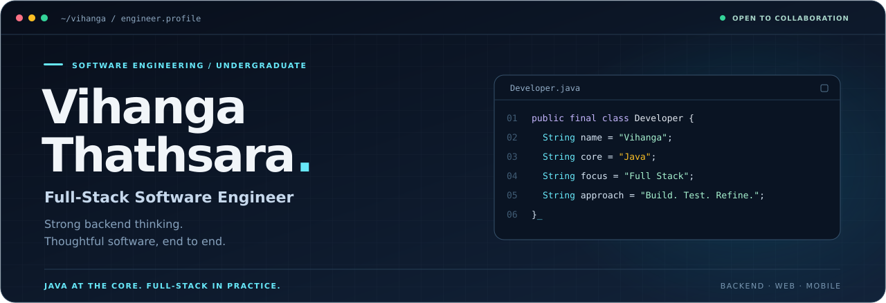
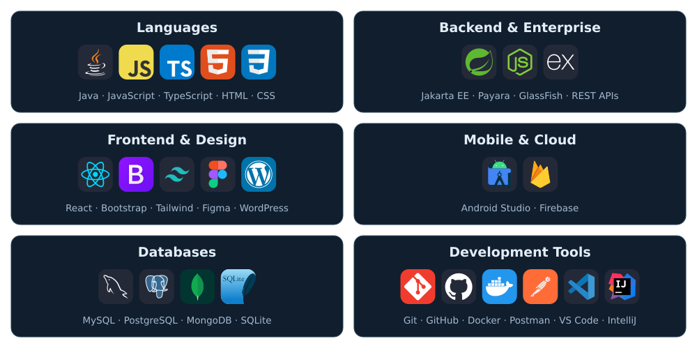
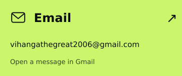
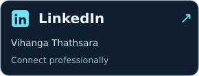
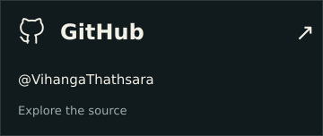

## About Me

I'm **Vihanga Thathsara Manukulasooriya**, a **Full-Stack Software Engineer** and **Software Engineering undergraduate** completing my degree.

**Java is my strongest language.** I build backend systems, web applications and native Android apps, connecting application logic, databases and user interfaces.

- **Backend & enterprise:** Java, Jakarta EE, REST APIs and relational databases.
- **Connected applications:** Android, Firebase and full-stack customer workflows.
- **Engineering priorities:** readable code, input validation, authentication and role-based access.

I'm currently preparing my projects for public release with clearer setup guides and demonstrations, and I'm open to collaboration on practical software projects.

## Tech Stack

## GitHub Activity

Language percentages describe public repository code, not proficiency.

## Connect

For collaboration, project discussions or a technical conversation:

<strong>Email:</strong> <a href="https://mail.google.com/mail/?view=cm&amp;fs=1&amp;to=vihangathegreat2006@gmail.com">vihangathegreat2006@gmail.com</a> 
<strong>LinkedIn:</strong> <a href="https://www.linkedin.com/in/vihanga-thathsara-00187543b/">Vihanga Thathsara</a>
&nbsp; · &nbsp;
<strong>GitHub:</strong> <a href="https://github.com/VihangaThathsara">@VihangaThathsara</a>

