<picture>
  <source media="(max-width: 600px)" srcset="assets/hero-motion-mobile.gif">
  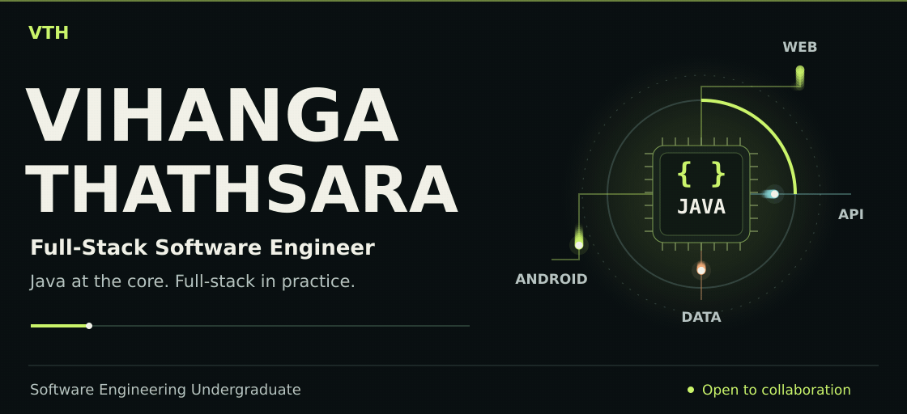
</picture>

  <a href="https://github.com/VihangaThathsara">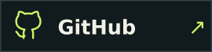</a>
  
  

<picture>
  <source media="(max-width: 600px)" srcset="assets/profile-mobile.png">
  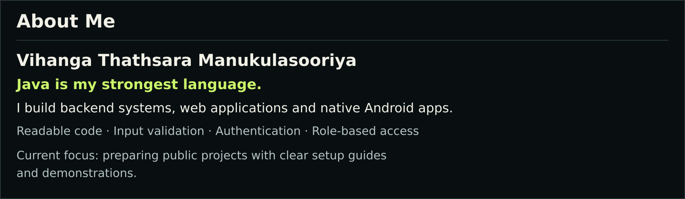
</picture>

<picture>
  <source media="(max-width: 600px)" srcset="assets/section-stack-mobile.png">
  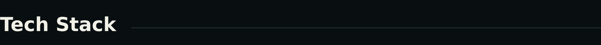
</picture>

  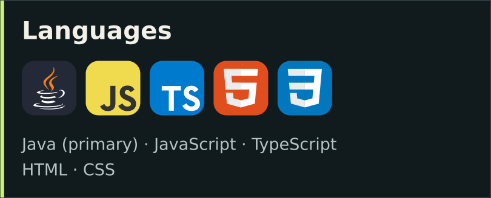
  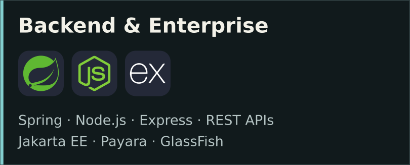
  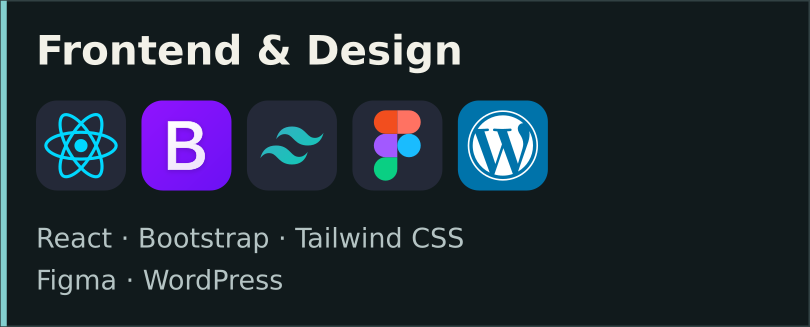
  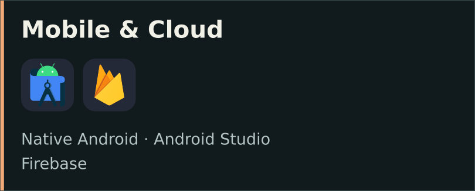
  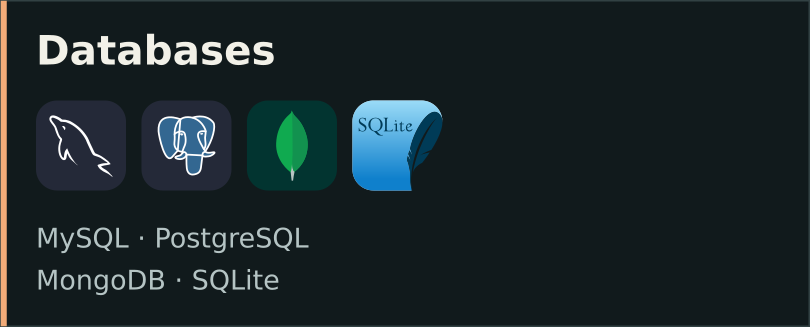
  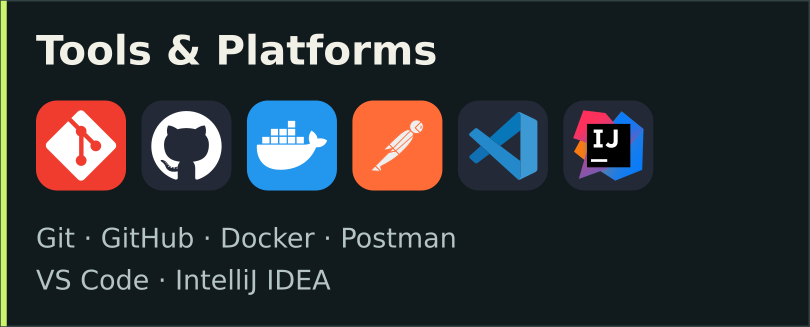

<picture>
  <source media="(max-width: 600px)" srcset="assets/section-activity-mobile.png">
  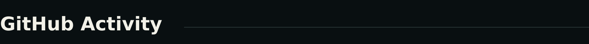
</picture>

<a href="https://github.com/VihangaThathsara?tab=repositories">
  <picture>
    <source media="(max-width: 600px)" srcset="assets/github-overview-mobile.svg">
    
  </picture>
</a>

<a href="https://github.com/VihangaThathsara?tab=repositories">
  <picture>
    <source media="(max-width: 600px)" srcset="assets/languages-mobile.svg">
    
  </picture>
</a>

<a href="https://github.com/VihangaThathsara?tab=overview">
  <picture>
    <source media="(max-width: 600px)" srcset="assets/contributions-mobile.svg">
    
  </picture>
</a>

<picture>
  <source media="(max-width: 600px)" srcset="assets/section-connect-mobile.png">
  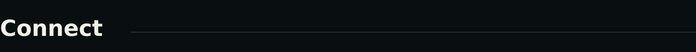
</picture>

  
  <a href="https://www.linkedin.com/in/vihanga-thathsara-00187543b/">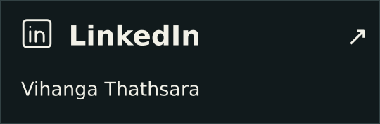</a>
  <a href="https://github.com/VihangaThathsara">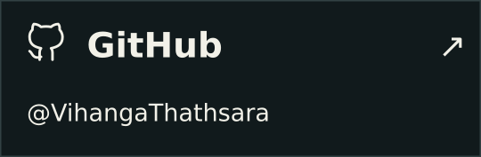</a>

  

