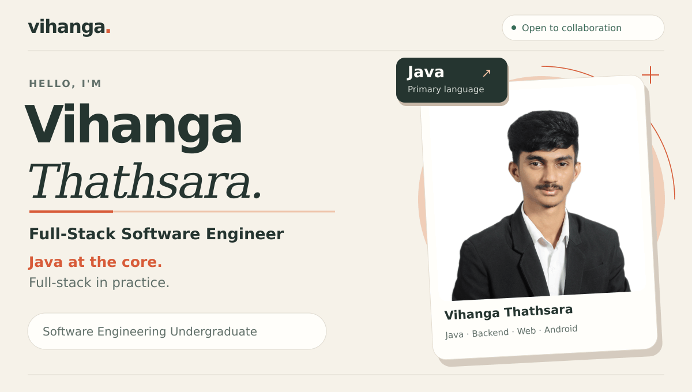
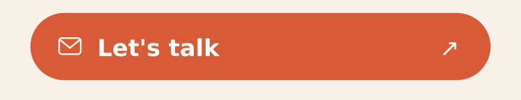
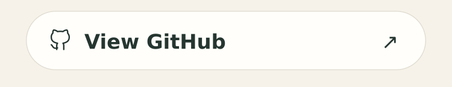
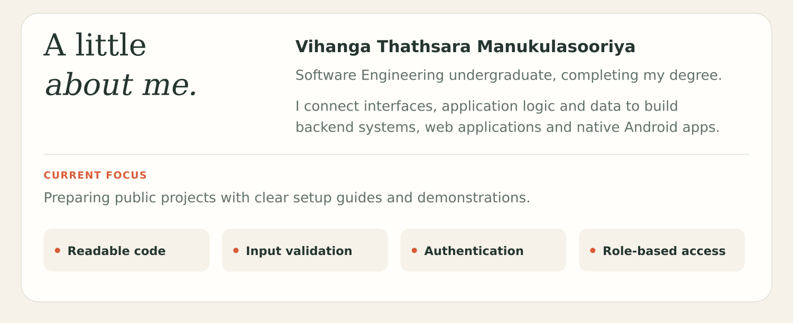
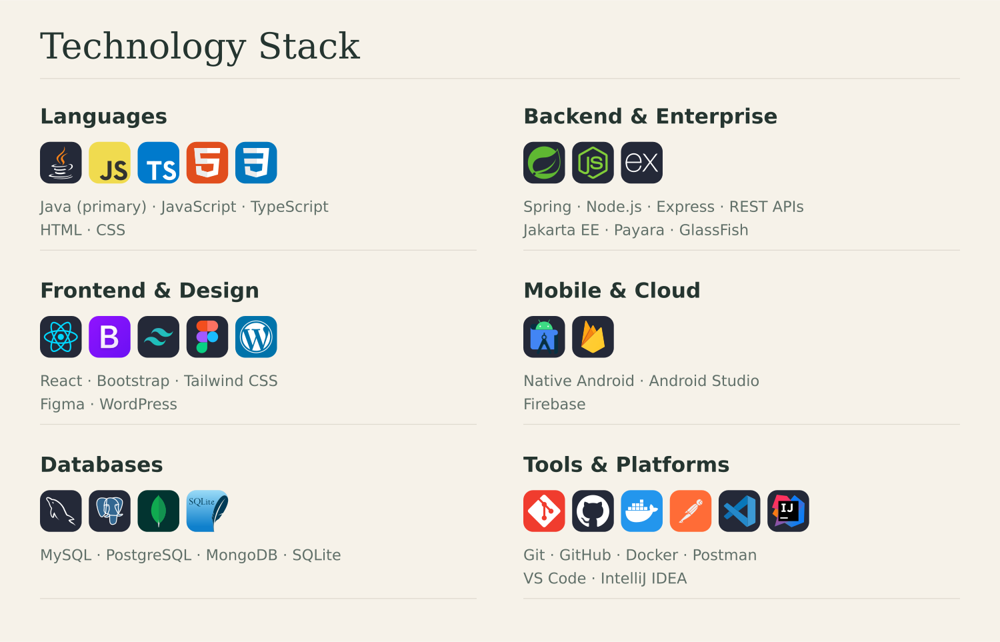
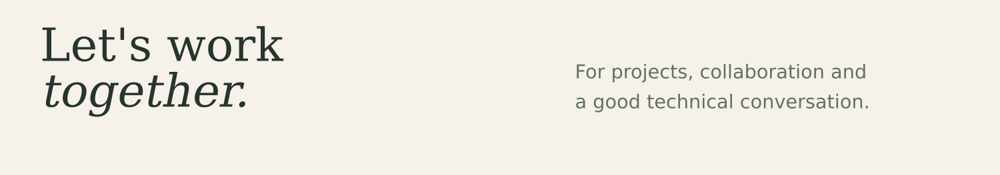
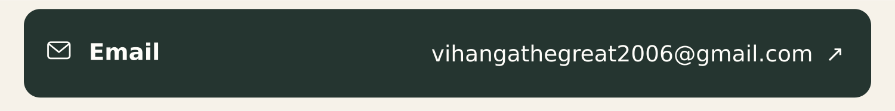
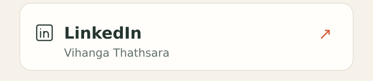
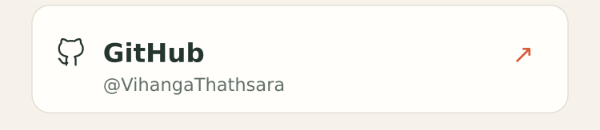
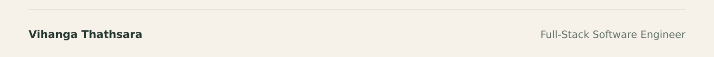

<picture>
  <source media="(max-width: 600px)" srcset="assets/portfolio-hero-mobile.gif">
  
</picture>
<a href="https://mail.google.com/mail/?view=cm&amp;fs=1&amp;to=vihangathegreat2006@gmail.com"><picture><source media="(max-width: 600px)" srcset="assets/portfolio-action-email-mobile.png"></picture></a><a href="https://github.com/VihangaThathsara?tab=repositories"><picture><source media="(max-width: 600px)" srcset="assets/portfolio-action-github-mobile.png"></picture></a>
<picture>
  <source media="(max-width: 600px)" srcset="assets/portfolio-about-mobile.png">
  
</picture>
<picture>
  <source media="(max-width: 600px)" srcset="assets/portfolio-skills-mobile.png">
  
</picture>
<a href="https://github.com/VihangaThathsara?tab=repositories"><picture>
  <source media="(max-width: 600px)" srcset="assets/github-overview-mobile.svg">
  
</picture></a>
<a href="https://github.com/VihangaThathsara?tab=repositories"><picture>
  <source media="(max-width: 600px)" srcset="assets/languages-mobile.svg">
  
</picture></a>
<a href="https://github.com/VihangaThathsara?tab=overview"><picture>
  <source media="(max-width: 600px)" srcset="assets/contributions-mobile.svg">
  
</picture></a>
<picture>
  <source media="(max-width: 600px)" srcset="assets/portfolio-connect-mobile.png">
  
</picture>
<a href="https://mail.google.com/mail/?view=cm&amp;fs=1&amp;to=vihangathegreat2006@gmail.com"><picture>
  <source media="(max-width: 600px)" srcset="assets/portfolio-email-mobile.png">
  
</picture></a>
<a href="https://www.linkedin.com/in/vihanga-thathsara-00187543b/"><picture><source media="(max-width: 600px)" srcset="assets/portfolio-social-linkedin-mobile.png"></picture></a><a href="https://github.com/VihangaThathsara"><picture><source media="(max-width: 600px)" srcset="assets/portfolio-social-github-mobile.png"></picture></a>
<picture><source media="(max-width: 600px)" srcset="assets/portfolio-footer-mobile.png"></picture>

