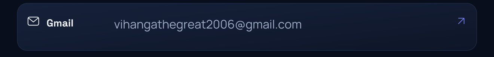
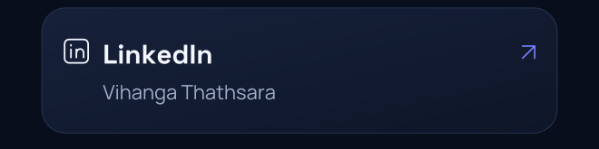
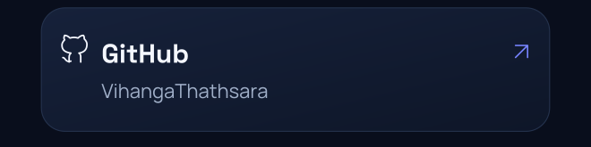

<picture><source media="(max-width: 600px)" srcset="assets/modern-hero-mobile.gif"></picture>
<picture><source media="(max-width: 600px)" srcset="assets/modern-about-mobile.png"></picture>
<picture><source media="(max-width: 600px)" srcset="assets/modern-stack-mobile.png"></picture>
<picture><source media="(max-width: 600px)" srcset="assets/github-overview-mobile.svg"></picture>
<picture><source media="(max-width: 600px)" srcset="assets/languages-mobile.svg"></picture>
<picture><source media="(max-width: 600px)" srcset="assets/contributions-mobile.svg"></picture>
<picture><source media="(max-width: 600px)" srcset="assets/modern-connect-mobile.png"></picture>
<a href="https://mail.google.com/mail/?view=cm&amp;fs=1&amp;to=vihangathegreat2006@gmail.com"><picture><source media="(max-width: 600px)" srcset="assets/modern-contact-email-mobile.png"></picture></a>
<a href="https://www.linkedin.com/in/vihanga-thathsara-00187543b/"><picture><source media="(max-width: 600px)" srcset="assets/modern-contact-linkedin-mobile.png"></picture></a><a href="https://github.com/VihangaThathsara"><picture><source media="(max-width: 600px)" srcset="assets/modern-contact-github-mobile.png"></picture></a>
<picture><source media="(max-width: 600px)" srcset="assets/modern-footer-mobile.png"></picture>

