

<picture>
  <source media="(max-width: 600px)" srcset="assets/modern-hero-mobile.gif">
  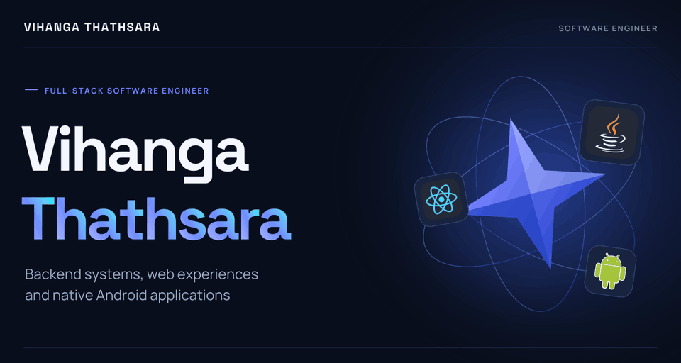
</picture>
<picture>
  <source media="(max-width: 600px)" srcset="assets/modern-about-mobile.png">
  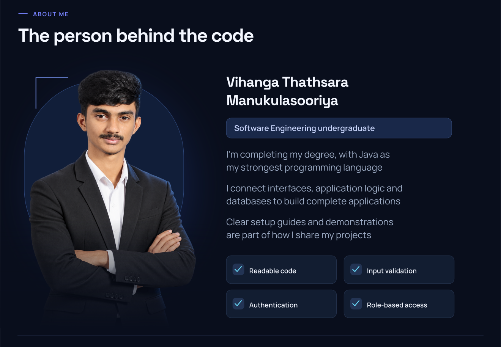
</picture>
<picture>
  <source media="(max-width: 600px)" srcset="assets/modern-stack-mobile.png">
  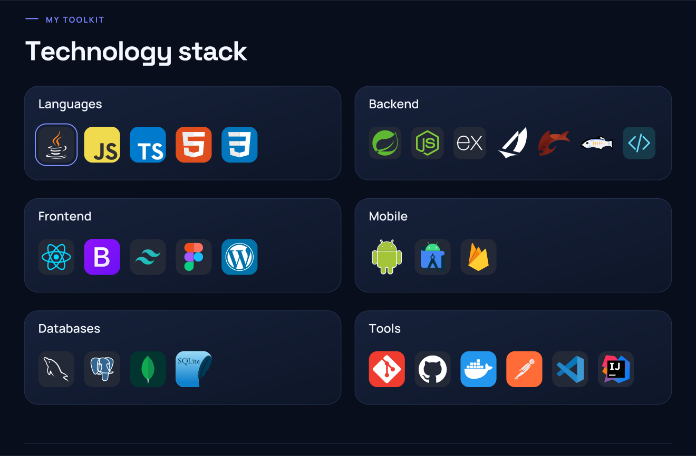
</picture>
<picture>
  <source media="(max-width: 600px)" srcset="assets/github-overview-mobile.svg">
  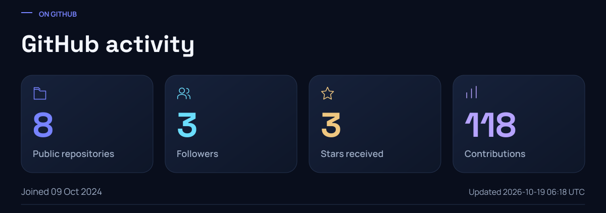
</picture>
<picture>
  <source media="(max-width: 600px)" srcset="assets/languages-mobile.svg">
  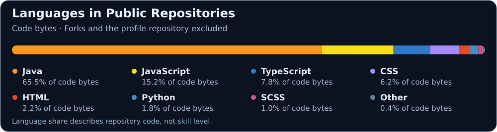
</picture>
<picture>
  <source media="(max-width: 600px)" srcset="assets/contributions-mobile.svg">
  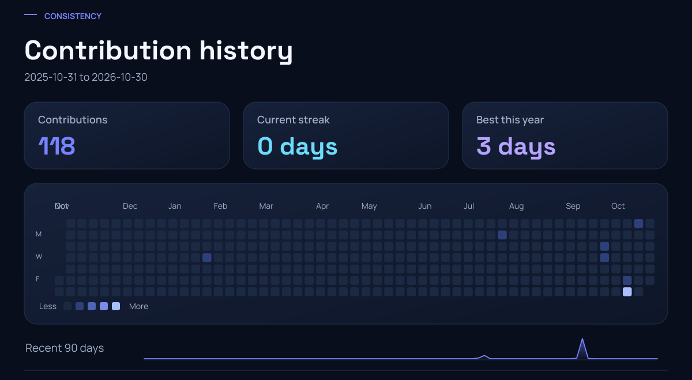
</picture>
<picture>
  <source media="(max-width: 600px)" srcset="assets/modern-connect-mobile.png">
  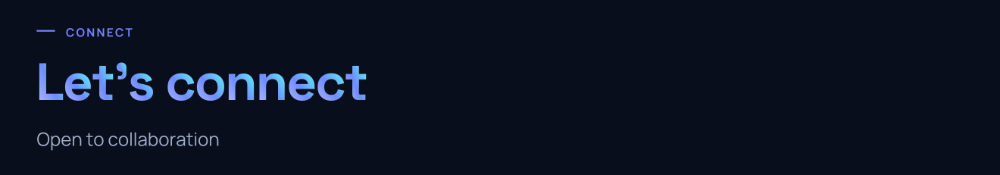
</picture>

<a href="https://mail.google.com/mail/?view=cm&amp;fs=1&amp;to=vihangathegreat2006@gmail.com">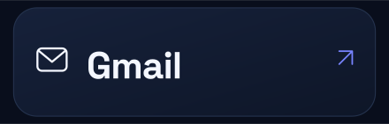</a><a href="https://www.linkedin.com/in/vihanga-thathsara-00187543b/">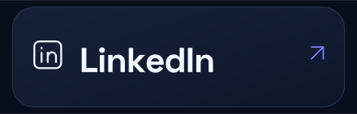</a><a href="https://github.com/VihangaThathsara">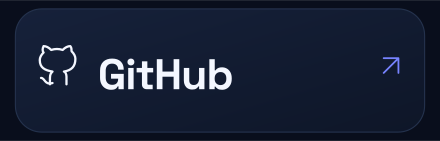</a>

<picture>
  <source media="(max-width: 600px)" srcset="assets/modern-footer-mobile.png">
  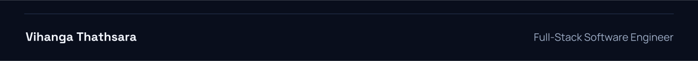
</picture>

