<!-- SOURCE / VTH — a repository-owned visual identity. -->

<picture>
  <source media="(prefers-reduced-motion: reduce) and (max-width: 600px)" srcset="assets/hero-mobile.svg">
  <source media="(prefers-reduced-motion: reduce)" srcset="assets/hero-still.svg">
  <source media="(max-width: 600px)" srcset="assets/hero-mobile.gif">
  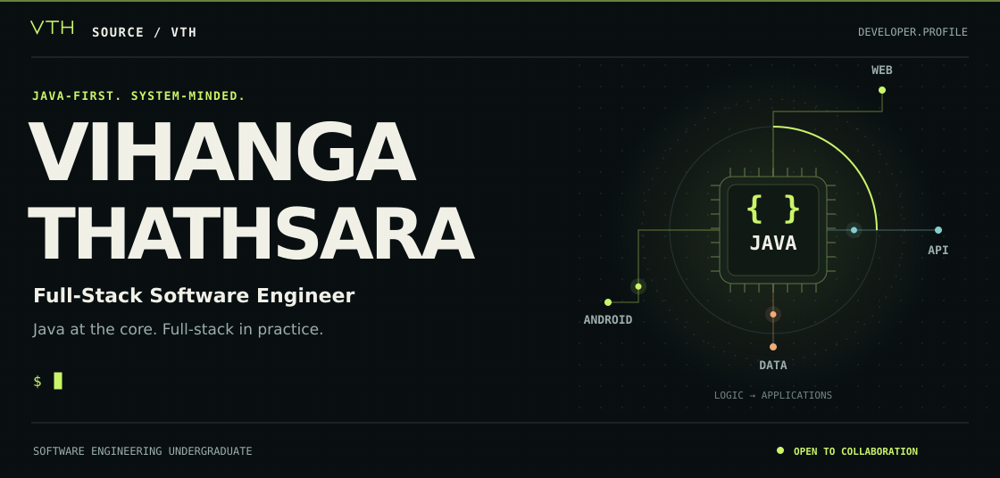
</picture>

<p align="center">
  <a href="https://github.com/VihangaThathsara"></a>
  <a href="https://mail.google.com/mail/?view=cm&amp;fs=1&amp;to=vihangathegreat2006@gmail.com"></a>
  <a href="https://www.linkedin.com/in/vihanga-thathsara-00187543b/"></a>
</p>

<p align="center">
  <a href="#profile">PROFILE</a> &nbsp; / &nbsp;
  <a href="#stack">STACK</a> &nbsp; / &nbsp;
  <a href="#activity">ACTIVITY</a> &nbsp; / &nbsp;
  <a href="#connect">CONNECT</a>
</p>

<a name="profile"></a>

<picture>
  <source media="(max-width: 600px)" srcset="assets/profile-mobile.svg">
  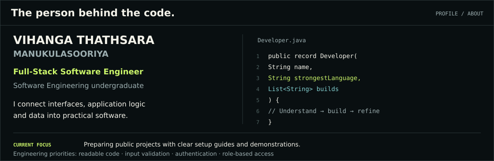
</picture>

<details>
<summary><b>Open Developer.java — the profile, as runnable Java</b></summary>

```java
import java.util.List;

public record Developer(
        String name,
        String strongestLanguage,
        List<String> builds
) {
    // Understand → build → refine
    public static void main(String[] args) {
        var me = new Developer(
                "Vihanga Thathsara Manukulasooriya",
                "Java",
                List.of("Backend systems", "Web applications", "Native Android apps")
        );

        System.out.println(me.name());
        System.out.println("Full-Stack Software Engineer");
        System.out.println("Software Engineering undergraduate, completing my degree");
        System.out.println("Strongest language: " + me.strongestLanguage());
        System.out.println("Building: " + String.join(", ", me.builds()));
        System.out.println("Priorities: readable code, input validation, authentication, role-based access");
        System.out.println("Focus: preparing public projects with clear setup guides and demonstrations");
        System.out.println("Open to collaboration on practical software projects");
        System.out.println("Email: vihangathegreat2006@gmail.com");
        System.out.println("GitHub: https://github.com/VihangaThathsara");
        System.out.println("LinkedIn: https://www.linkedin.com/in/vihanga-thathsara-00187543b/");
    }
}
```

Run the [source file](profile/Developer.java) from the repository root with Java 17 or later:

```bash
java profile/Developer.java
```

</details>

<a name="stack"></a>

<picture>
  <source media="(max-width: 600px)" srcset="assets/section-stack-mobile.svg">
  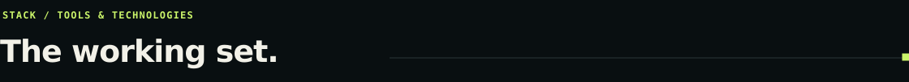
</picture>

<p align="center">
  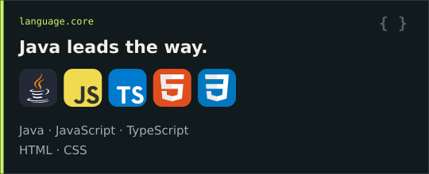
  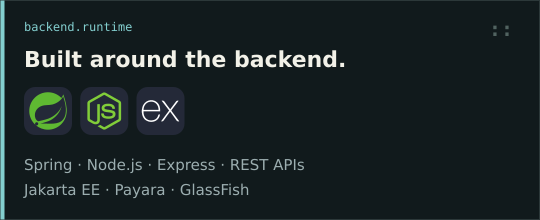
  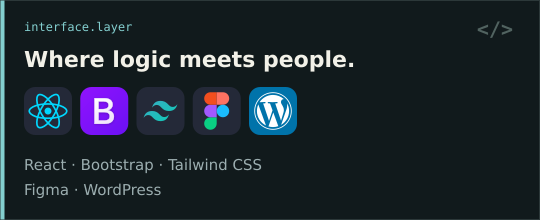
  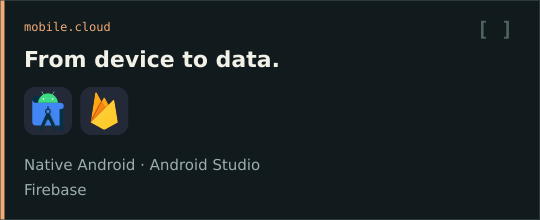
  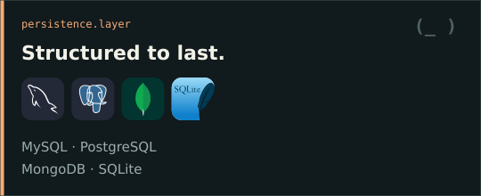
  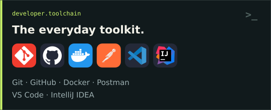
</p>

<details>
<summary><b>Read the complete technology stack</b></summary>

| Layer | Technologies |
| --- | --- |
| Languages | **Java — primary**, JavaScript, TypeScript, HTML, CSS |
| Backend & enterprise | Jakarta EE, Spring, Node.js, Express, REST APIs, Payara, GlassFish |
| Frontend & design | React, Bootstrap, Tailwind CSS, Figma, WordPress |
| Mobile & cloud | Native Android, Android Studio, Firebase |
| SQL & NoSQL | MySQL, PostgreSQL, MongoDB, SQLite |
| Development tools | Git, GitHub, Docker, Postman, VS Code, IntelliJ IDEA |

</details>

<a name="activity"></a>

<picture>
  <source media="(max-width: 600px)" srcset="assets/section-activity-mobile.svg">
  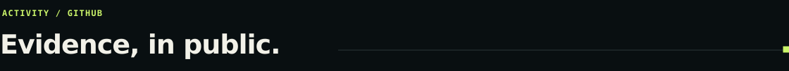
</picture>

<a href="https://github.com/VihangaThathsara?tab=repositories">
  <picture>
    <source media="(max-width: 600px)" srcset="assets/github-overview-mobile.svg">
    
  </picture>
</a>

<a href="https://github.com/VihangaThathsara?tab=repositories">
  <picture>
    <source media="(max-width: 600px)" srcset="assets/languages-mobile.svg">
    
  </picture>
</a>

<a href="https://github.com/VihangaThathsara?tab=overview">
  <picture>
    <source media="(max-width: 600px)" srcset="assets/contributions-mobile.svg">
    
  </picture>
</a>

<p align="center"><sub>Real public GitHub data · Refreshed by a scheduled workflow · Streaks cover the displayed year</sub></p>

<a name="connect"></a>

<picture>
  <source media="(max-width: 600px)" srcset="assets/section-connect-mobile.svg">
  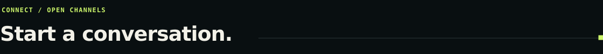
</picture>

<p align="center">
  <a href="https://mail.google.com/mail/?view=cm&amp;fs=1&amp;to=vihangathegreat2006@gmail.com"></a>
  <a href="https://www.linkedin.com/in/vihanga-thathsara-00187543b/"></a>
  <a href="https://github.com/VihangaThathsara"></a>
</p>

<p align="center">
  <a href="https://mail.google.com/mail/?view=cm&amp;fs=1&amp;to=vihangathegreat2006@gmail.com">vihangathegreat2006@gmail.com</a><br>
  <a href="https://www.linkedin.com/in/vihanga-thathsara-00187543b/">LinkedIn</a> &nbsp; · &nbsp;
  <a href="https://github.com/VihangaThathsara">GitHub</a>
</p>

<p align="center">
  
</p>

<picture>
  <source media="(max-width: 600px)" srcset="assets/footer-mobile.svg">
  
</picture>
